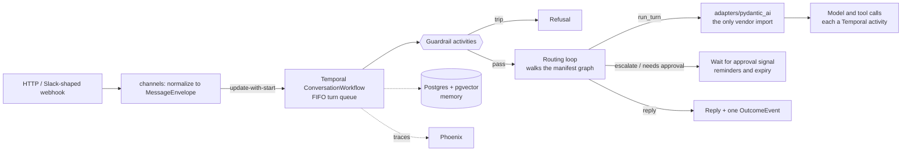

# agent-chassis

A runtime **chassis** for role-based AI agents ("Employees"). An Employee is a declarative **role manifest** (one YAML file) plus reusable **capability packs**, never a new codebase. The chassis supplies durable execution ([Temporal](https://temporal.io)), channels (HTTP and a Slack-shaped webhook), input guardrails, memory (Postgres + pgvector), tracing, human-approval escalation, outcome events, and an eval harness. A role provides only configuration.

> **This is a demo project.** "Brightloop" (a webhook-delivery SaaS) and the example Employees built on it are fictional. All customer data, invoices, tickets, and knowledge-base content in `examples/` are invented mock data, and the billing tools act on an email address with no authentication. It is a design and engineering showcase, not a hardened product; see [Known limitations](#known-limitations).

> **Where to read next:** the architecture below, then [`DESIGN.md`](DESIGN.md), the numbered decision log (`D1`...`D24`) with the rejected alternatives for each choice. Code comments cite decisions like "(D13)"; the [glossary](#design-decisions-at-a-glance) at the bottom is the quick version.

## The one big idea

Onboarding a new Employee should be **new YAML, not new code.** Everything that varies between Employees (persona, capabilities, routing between specialists, which guardrails run and at what thresholds, what needs human approval, what runs on a schedule) lives in a manifest. The Python in `src/` is the chassis: it is identical for every Employee and never mentions a specific one (a test scans the source to enforce that).

Two Employees ship in [`examples/`](examples/) as permanent fixtures, plus a minimal third:

- **Lana**: customer service (a routing supervisor, billing and support specialists, guardrails, memory). Proves the chassis can carry a real multi-agent conversational role. Ships 12 eval cases.
- **Nova**: operations reporting. Runs on a cron schedule and **pauses for human approval** before publishing. Proves a very different role shape needs zero chassis changes.
- **Echo** (`skeleton/`): one agent, one trivial tool. The walking skeleton, and the default role for `docker compose up`.

## How it works



- **The adapter seam (D2).** The chassis owns all deterministic orchestration (message loop, routing, escalation, timers, continue-as-new) and depends only on the vendor-free types in [`contracts/`](src/agent_chassis/contracts/). Only code under [`adapters/`](src/agent_chassis/adapters/) may import the agent framework (`pydantic_ai`). This is enforced in CI by import-linter, not left to convention.
- **Routing is the chassis's job (D4).** Agents return a structured directive (`reply`, `route`, `escalate`, `needs_approval`). The chassis walks the manifest's routing graph; an illegal or over-budget route is an error, never a silent fallback.
- **Durable by construction (D1, D6a).** Conversation history is workflow state carried through continue-as-new, and every model and tool call is its own activity. A worker can be killed mid-conversation or mid-approval and the work resumes.
- **Human approval is a workflow state (D10, D11).** A gated tool pauses the task, possibly for days. Decisions are attributed to the authenticated principal and written to an append-only audit log.
- **Fail closed.** The worker refuses to start without a payload-encryption key (D9), manifests reject unknown fields and out-of-bounds guardrail thresholds (D7), and approval endpoints refuse to serve unauthenticated (D21).
- **Observability (D19).** One readable trace tree per turn, with guardrails as first-class spans, exported to [Arize Phoenix](https://github.com/Arize-ai/phoenix) when `PHOENIX_COLLECTOR_ENDPOINT` is set.

### The lifecycle of one message

1. **`channels/http.py`** receives `POST /v1/messages`, builds a `MessageEnvelope`, and does an update-with-start (D3): the first message starts a `ConversationWorkflow`, later ones attach to the running one.
2. **`durable/workflows.py`** enqueues it on an in-workflow FIFO queue (D13) so concurrent messages never interleave.
3. **Guardrails (D5)**: each configured guardrail runs as its own activity; a trip short-circuits the turn with a refusal.
4. **Routing loop (D4)**: the current agent runs a turn through the adapter and returns a directive; the chassis follows only edges the manifest declares.
5. **`adapters/pydantic_ai/adapter.py`** is where the vendor agent executes.
6. **Reply** returns through the update result (sync channels like HTTP) or is pushed by an outbound activity, idempotent per delivery key (async channels like Slack, D15).
7. On idle, the workflow emits one versioned **`OutcomeEvent`** (D12) and completes.

Scheduled work (Nova) takes a parallel path through `TaskWorkflow`, which adds the durable approval state machine.

## Quickstart

Requires Python 3.13+ with [`uv`](https://docs.astral.sh/uv/), and Docker for the full stack. The default models are OpenAI's, so running an Employee needs an API key.

```bash
# .env at the repo root. The worker fails closed without a codec key (D9).
echo "TEMPORAL_PAYLOAD_CODEC_KEY=$(openssl rand -base64 32)" >> .env
echo "OPENAI_API_KEY=sk-..."                                >> .env

docker compose up --build                            # the Echo skeleton
ROLE_DIR=./examples/lana docker compose up --build   # or Lana
```

| Service | URL |
|---|---|
| HTTP API | http://localhost:8001 |
| Temporal UI | http://localhost:8234 |
| Postgres (pgvector) | localhost:5433 (`chassis` / `chassis`) |

```bash
curl -s localhost:8001/v1/messages -H 'content-type: application/json' \
  -d '{"conversation_id":"c1","message":"reverse the word chassis"}'
```

With Lana running, try the mock accounts `dana@example.com` (Pro) and `sam@example.org` (Starter): *"What plan is dana@example.com on?"*, then *"Is Brightloop SOC 2 compliant?"* to watch the supervisor route between billing and support.

| Endpoint | Purpose |
|---|---|
| `POST /v1/messages` | Send a message; the reply rides the workflow update result |
| `GET /v1/self` | The Employee's self-description (capabilities and recent performance) |
| `POST /v1/tasks`, `GET /v1/tasks/{id}` | Start and poll a scheduled or one-shot task |
| `POST /v1/approvals` | Approve or deny a paused tool call (requires authentication) |
| `POST /v1/webhooks/slack` | Slack-shaped inbound webhook (HMAC-verified when configured) |
| `GET /healthz` | Liveness |

## Tests and evals

```bash
uv sync                                          # Python is pinned in .python-version
uv run pytest tests/unit                         # fast, no network or services
uv run pytest --cov                              # everything: 94 tests
uv run ruff format --check . && uv run ruff check .
uv run lint-imports                              # the adapter seam contract (D2)
```

The unit tests need nothing external. The integration tests run Temporal's in-process test server, and the pgvector tests start a throwaway Postgres container, so Docker must be running. CI runs lint, import-linter, and the full suite with an 80% coverage gate (currently about 84%).

The **eval harness** (D17) drives real conversations through a running Employee and grades them. Lana's suite has 12 cases, including multi-turn and cancel-discipline cases. With the stack up:

```bash
EVAL_JUDGE_MODEL=openai:gpt-5.4-mini-2026-03-17 \
  python -m agent_chassis.evals http://localhost:8001 examples/lana/evals
```

Each case declares only the expectations it cares about: the expected agent, expected or forbidden tools, the directive, per-guardrail pass or trip, and a free-text quality rubric. The quality grader is an LLM judge that sees the full conversation and returns a binary verdict with its reasoning stated first. Evals make real model calls and cost money.

## Configuration

Settings load from environment variables or `.env` ([`config.py`](src/agent_chassis/config.py) is authoritative; [`.env.example`](.env.example) lists them all).

| Variable | Default | Purpose |
|---|---|---|
| `OPENAI_API_KEY` | required for OpenAI tiers | Model access |
| `MODEL_TIER_LIGHT` / `_STANDARD` / `_FRONTIER` | `openai:gpt-4o-mini` / `openai:gpt-5.4-mini-2026-03-17` / unset | Maps abstract tiers to concrete models. Any provider-prefixed pydantic-ai string works, e.g. `anthropic:...`. A manifest requesting an unset tier fails loudly |
| `TEMPORAL_PAYLOAD_CODEC_KEY` | required by the worker | Base64 32-byte AES-GCM key; no key, no start (D9) |
| `TEMPORAL_ADDRESS` / `_NAMESPACE` / `_TASK_QUEUE` | `localhost:7233` / `default` / `agent-chassis` | Temporal connection |
| `MANIFEST_PATH` | required | The role manifest to run |
| `PACKS_DIR` | unset | Directory of role-supplied capability packs |
| `POSTGRES_URL` | unset | Memory substrate; a manifest with `substrate: none` runs without it |
| `PHOENIX_COLLECTOR_ENDPOINT` | unset | Tracing is disabled when unset |
| `HTTP_BEARER_TOKENS` | unset | `token:principal,...`. When set, every `/v1/*` call needs a token (D21) |
| `SLACK_SIGNING_SECRET`, `SLACK_WEBHOOK_URL` | unset | Verify inbound Slack-shaped webhooks; push replies out |
| `CONVERSATION_IDLE_SECONDS` | `3600` | Idle timeout before a conversation completes |
| `TENANT` | `local` | A correlation label only, never an isolation mechanism (D16) |

Manifests name abstract model tiers (`light`, `standard`, `frontier`), never a concrete model, so roles stay portable across providers and model generations.

## Writing a new Employee

1. Write a `manifest.yaml`; copy [`examples/skeleton/manifest.yaml`](examples/skeleton/manifest.yaml) and grow it (schema in [`manifest/schema.py`](src/agent_chassis/manifest/schema.py)).
2. If it needs new tools, write a **capability pack**: a `CapabilityPack` subclass in a `packs/` directory exposing a module-level `PACKS` list. See [`examples/lana/packs/billing.py`](examples/lana/packs/billing.py).
3. Point `MANIFEST_PATH` (and `PACKS_DIR`) at them.
4. Bundle eval cases with the role and gate on the pass rate.

The loader is fail-closed: unknown fields, illegal routes, undeclared capabilities, and out-of-bounds thresholds are validation errors that name the offending path.

## Repository layout

```
src/agent_chassis/
  contracts/    vendor-free types every seam speaks (read this first)
  manifest/     role manifest schema v1 and fail-closed loader
  packs/        capability and guardrail packs, and the registry
  adapters/     runtime adapters; the only code that imports the agent SDK
  durable/      Temporal workflows, activities, payload codec, schedules
  channels/     HTTP and Slack-shaped adapters
  memory/       retrieval and write-back substrate (Postgres + pgvector)
  evals/        case schema, runner, graders, LLM judge
  utils/        provider-agnostic LLM helper and logging
  config.py, role_loader.py, api.py, worker.py, introspection.py, observability.py
examples/       lana, nova, skeleton
tests/          unit and integration tests
scripts/        reproducible image build
DESIGN.md       the numbered decision log
PATCHES.md      active workflow.patched() ledger (D14)
```

Every package folder has its own README. A role runs as two processes off one image (D18): an HTTP `api` unit and a Temporal `worker` unit, both pointed at the same manifest.

## Design decisions at a glance

Full text and rejected alternatives are in [`DESIGN.md`](DESIGN.md). Decisions are implemented unless marked otherwise.

| Ref | In one line |
|---|---|
| **D1** | Runtime is pydantic-ai wrapped by Temporal's `TemporalAgent` (per-call durability). |
| **D2** | The adapter seam: the chassis is vendor-free; only `adapters/` imports the SDK. Enforced in CI. |
| **D3** | Messages enter via Temporal update-with-start, so a reply can ride the result. |
| **D4** | Routing is chassis-owned: agents emit structured directives; the chassis walks the graph. |
| **D5** | Input guardrails run as pre-flight activities; output checks as validators. |
| **D6 / D6a** | Two workflow types (conversation, task). Conversation history is workflow state; no session store. |
| **D7** | Manifest schema v1: versioned, `extra="forbid"`, naming-stable identifiers, fail-closed. |
| **D8** | Memory is retrieval plus write-back behind one interface (pgvector today). |
| **D9** | Payload encryption fails closed: no codec key, no worker. |
| **D10 / D11** | Human escalation is a first-class workflow state; one append-only audit log for overrides and approvals. |
| **D12** | Each completed conversation or task emits one versioned `OutcomeEvent`. |
| **D13** | Inbound turns are serialized through an in-workflow FIFO queue. |
| **D14** | Workflow changes ship behind `workflow.patched()`; ledger in `PATCHES.md`. |
| **D15** | Outbound delivery is at-least-once and idempotent per structured delivery key. |
| **D16** | One tenant per deployment; isolation is the deployment environment's job. |
| **D17** | Evals are chassis machinery: versioned case schema, full-conversation binary judge. |
| **D18** | Two units (HTTP and worker) off one image. |
| **D19** | Traces: one readable tree per turn, guardrails as first-class spans. |
| **D20** | Role artifacts split by trust tier: curated packs baked into the image, tenant packs mounted. |
| **D21** | Channel auth: the audited identity is the authenticated principal, never caller-supplied. |
| **D22 / D23** | Memory provenance: every entry records source and author; recalled content is labeled data, not instructions. **D23 is implemented.** |
| **D24** | Scoped retrieval API and per-turn identity spine. **Proposed, not implemented.** |

## Known limitations

- **Demo data and no real backends.** Brightloop is fictional. The billing and support backends are stateless mocks, and the billing tools act on an email address with no authentication.
- **Authentication is a placeholder.** Bearer tokens come from an environment variable (D21). Without them, `/v1/messages` serves anonymously (logged), while `/v1/tasks` and `/v1/approvals` refuse to serve. Real SSO or OIDC is not implemented.
- **The Slack channel is Slack-shaped.** It is tested against a fake; there is no Slack app, OAuth flow, or real workspace integration.
- **Single tenant per deployment (D16).** Tenant isolation is assumed to come from the environment; the `tenant` field is only a label.
- **Role packs are not sandboxed.** Code loaded from `PACKS_DIR` runs with the worker's full privileges (D20). That is acceptable only when the deployment isolates each tenant.
- **Memory is pgvector only,** and memory retrieval is employee-wide. The scoped retrieval API and MCP exposure in D22 and D24 are designed but not built.
- **Guardrails and the eval judge are LLM-based** and therefore probabilistic. They reduce risk; they do not eliminate it.
- **One runtime adapter.** The seam is designed and import-enforced, but only the pydantic-ai adapter exists, so it has not been proven against a second SDK.
- **Not load-tested, and no production deployment manifests.** The repo ships a Dockerfile, a compose file, and a reproducible image build script; a Kubernetes deployment is left to the operator.

## Development conventions

- **Python 3.13** (pinned in `.python-version`), managed with `uv`; formatting and linting with `ruff`.
- **The seam is sacred.** A new chassis package must be listed in the import-linter contract in [`pyproject.toml`](pyproject.toml) so it is forbidden from importing the vendor SDK.
- **Fail closed, fail loud.** A missing encryption key, an unknown manifest field, or an unattributable approval stops the process or returns an error; none degrades silently.
- **Zero role special-casing.** No chassis code branches on a specific Employee's name.

## License

No license is granted. The source is published so it can be read and reviewed; please do not copy, redistribute, or reuse it without permission. All rights reserved.
